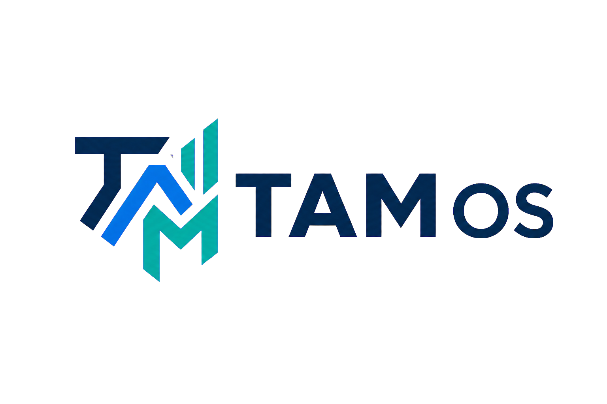
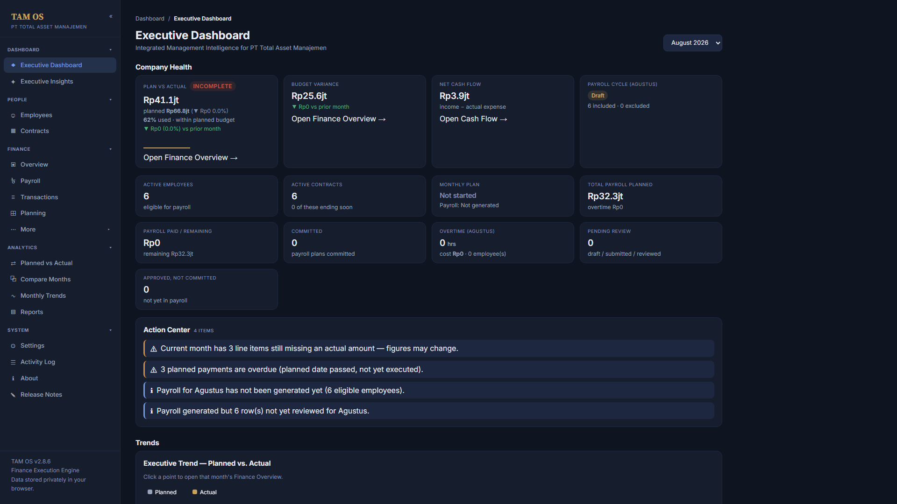
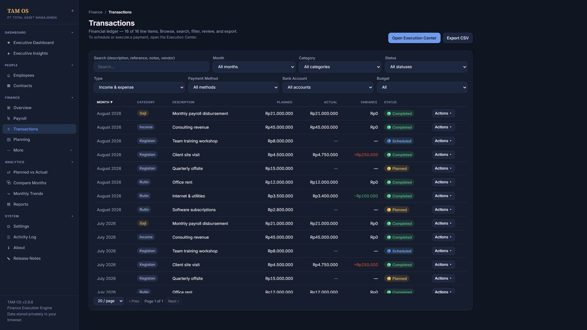
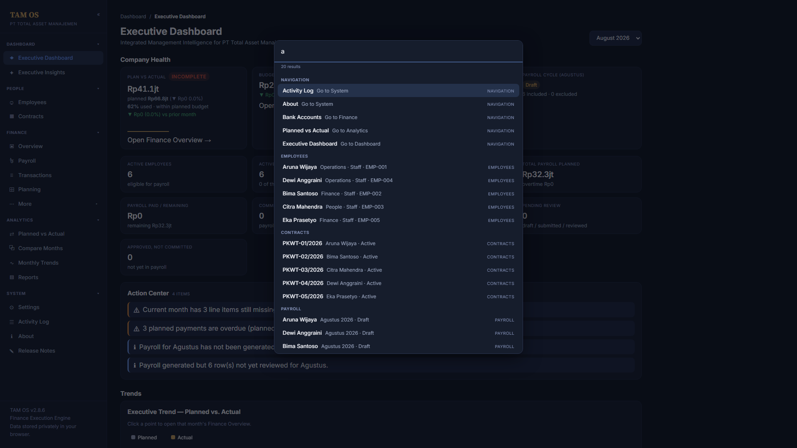
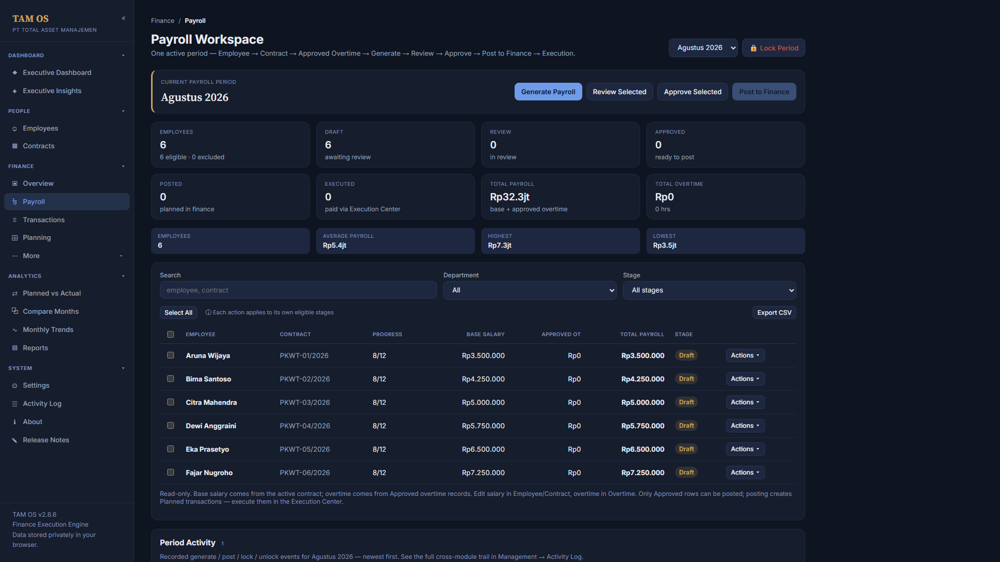

<div align="center">



# TAM OS

**Integrated Management Intelligence for PT Total Asset Manajemen** — a single-page finance,
payroll, and operations workspace. The shipped application runs entirely in the browser; a
same-origin backend for future multi-user use is being built as source only and is not deployed.

</div>

[](https://github.com/fanoryu/TAM-OS-Next/actions/workflows/ci.yml)
[](https://github.com/fanoryu/TAM-OS-Next/actions/workflows/attribution.yml)


Read [docs/STATUS.md](docs/STATUS.md) for the central development and gate record.

> **Publicly viewable source — company data is separate.** This is the **source core** of TAM
> Intelligence OS: application source, tooling, docs, and an empty-data default. Production company data
> and configuration are **maintained separately** in a private company layer (see
> [`docs/DEPLOYMENT.md`](docs/DEPLOYMENT.md)); the application ships **no** company data and requires
> none to run. **Licensing:** the source repository is publicly viewable, but TAM OS remains
> **proprietary and all rights reserved** under the current [`LICENSE`](LICENSE) — public visibility does
> **not** grant permission to use, copy, modify, redistribute, sublicense, or commercialize the software
> except as explicitly permitted by that license, and this repository is **not** open source.
> Do **not** commit real company, employee, payroll, or backup data.

---

## Overview

TAM OS is an internal operations tool for **PT Total Asset Manajemen**. It manages the monthly cycle
for finance and people operations — employees and contracts, overtime, payroll generation and posting,
transaction execution, cash flow, budgeting, and reporting — as a browser application.

- **No framework, one pinned dependency.** Plain HTML, CSS, and classic-script JavaScript sharing one
  global scope; in the current source the only runtime dependency is the vendored, integrity-checked
  SheetJS parser. Node.js is used **only** for the build/verify tooling, never to run the app. Typography
  is embedded and the source package makes no third-party network request (the published v2.11.0 file
  still loads its `.xlsx` parser from a CDN).
- **One canonical distribution.** The modular source is assembled, byte-for-byte, into a static
  **deployment package** that runs over HTTP under a strict Content-Security-Policy (Distribution-1).
  Published single-file releases remain available as frozen history.
- **Data-safety first.** An invariant verifier and a suite of runtime harnesses guard the persisted-data
  schema, storage keys, migration flags, and build fidelity on every change (current counts:
  [`tools/README.md`](tools/README.md)).

---

## Status at a glance

The central release, deployment and production gate status is maintained in [docs/STATUS.md](docs/STATUS.md).
This section is orientation only; it authorizes nothing, and where it differs from that record, the record wins.

- **Published release.** **v2.11.0 — Identity Refresh** is **published** and **marked Latest**, from
  annotated tag `v2.11.0` in `fanoryu/TAM-OS-Next`. It is a client-only single HTML file
  (`AUTH_MODE` LOCAL): data stays in the browser profile and nothing is sent to a server. Its "Acting as"
  selector is a **local, trust-based application context, not authentication**, and not a security
  boundary against anyone with local access to the device, browser profile or portable file.
- **Unreleased on `main`.** The **v3.0.0 — Core SESSION Foundation** candidate: a signed-in application
  (`AUTH_MODE` SESSION) built as the Distribution-1 package against the same-origin PHP 8.3 + MariaDB
  backend under `server/`
  ([ADR-0004](docs/03b-repository-adr/ADR-0004-hostinger-same-origin-backend.md)). It is **source only
  and not deployed**, it is not production-ready, it covers the Core SESSION areas only, and
  browser-stored v2.x data is not migrated. Scope and limits: [`RELEASE_NOTES.md`](RELEASE_NOTES.md).
- **Gates.** Every release, deployment and production gate is currently restrictive, and the controlled
  internal pilot (**PILOT-1**) remains **ON HOLD** — it never launched and no real company data has been
  entered. See [docs/STATUS.md](docs/STATUS.md) for central gate status and [AI_CONTEXT.md](AI_CONTEXT.md)
  and [docs/DEPLOYMENT.md](docs/DEPLOYMENT.md) for additional pilot and operational context; a release,
  tag or deployment needs separate, explicit Owner authorization ([`CLAUDE.md`](CLAUDE.md) §20).
- **Previous release.** v2.10.0 (Governed Workspace) remains **published** and intact. It was
  **originally published** from the predecessor repository **`fanoryu/TAM-OS`** (private predecessor
  repository retained for historical provenance — not resolvable by public visitors) and
  **canonically re-published** unchanged from `fanoryu/TAM-OS-Next` under annotated tag `v2.10.0`. Its asset
  `tam-os-v2.10.0.html` (1,151,267 bytes, SHA-256
  `60382271a6dcea23431fabb91e0d16abb03196e5cf64c6dc4da1e1af2c7fa704`) is **byte-identical** across both
  Releases. Earlier releases and the migration record: [`RELEASE_NOTES.md`](RELEASE_NOTES.md),
  [`CHANGELOG.md`](CHANGELOG.md) and [`PROVENANCE.md`](PROVENANCE.md).

---

## Product preview

Captured from the frozen UX-005 interface (dark theme) using clearly-labelled fabricated demo data.

**Executive Overview** — Company Health KPIs, the navigation-only Action Center, and executive trends.



**Financial Operations** — the Transactions ledger on the shared Data Grid: search, filters, sortable
columns, planned vs. actual with variance, status pills, pagination, and CSV export.



**Global Search** — the `Ctrl/Cmd+K` command palette, with navigation-only results across Navigation,
Employees, Contracts, and Payroll.



**Payroll Workspace** — period KPIs and the Draft → Review → Approve → Post → Execute lifecycle over a
read-only worksheet.



---

## Product capabilities

- **Finance operations** — a transaction ledger with planned vs. actual amounts, an Execution Center to
  execute/schedule/cancel payments, cash-flow and budget views, and a financial calendar.
- **People & payroll** — employees and contracts with work schedules; a Payroll Workspace running
  Draft → Review → Approved → Posted → Executed over a read-only worksheet; a TAM-method overtime engine
  that feeds approved overtime into payroll; and Supplemental Payments that settle overtime approved
  after payroll is immutable.
- **Payroll integrity & history** — Posted/Executed payroll renders from immutable committed snapshots;
  committed financial history is never reconstructed or auto-repaired.
- **Planning & analytics** — a monthly plan generator, planned-vs-actual and month-over-month
  comparisons, trend charts, and an executive dashboard.
- **Data import** — Smart Import extracts employees/contracts/transactions from spreadsheets with column
  mapping, conflict handling, and duplicate prevention.
- **Governance & recovery** — a read-only Activity Log (audit trail), Complete Backup / Restore, CSV
  exports, and typed-confirmation safeguards around destructive actions.

This list describes the published v2.11.0 release. The SESSION candidate on `main` does not expose all
of these areas yet; see *Incomplete work and limitations* in [docs/STATUS.md](docs/STATUS.md).

---

## Getting started

**Run the published release (v2.11.0).**

1. Get **`tam-os-v2.11.0.html`** — the tracked artifact at
   [`dist/tam-os-v2.11.0.html`](dist/tam-os-v2.11.0.html), or the identical asset from this repository's
   Latest `v2.11.0` Release.
2. *(Recommended)* Verify it — `Get-FileHash tam-os-v2.11.0.html -Algorithm SHA256` (PowerShell) or
   `shasum -a 256 tam-os-v2.11.0.html`. Expect **1,676,709 bytes** / SHA-256
   `57d8b0c23c83509a70a766d903e2ee19aa57e5bcfc70950652d930e8f2358557`.
3. Open it in a **desktop Chromium browser**. No install, no server, no build step. Fonts are embedded;
   `.xlsx` import in this file still needs the CDN-hosted parser (`.csv` does not).
4. Data stays **local to that browser profile**. Export via **Settings → Complete Backup**.

**Build and serve the current source.** No framework and no `npm install` are required. Build the
deployment package and serve it over HTTP under the production header contract (CSP included):

```bash
node tools/build-package.js
node tools/serve-package.js
```

Then open <http://127.0.0.1:8765/>. `file://` is not supported for the current source. The source runs in
SESSION mode, so signing in needs a backend; the test-only loopback servers for local QA are indexed in
[`tools/README.md`](tools/README.md). Use fabricated data only.

---

## Development

**Toolchain:** Node.js (tested on **v24**; any v18+ works) with no dependencies — nothing to
`npm install`.

```bash
node tools/verify-build.js
node tools/build-package.js
```

1. **Confirm the baseline** — clean working tree, expected branch, latest commit and release tag.
2. **Edit the modular source only** — never generated output or the frozen releases in `dist/`. If you
   add or move a module, update `tools/module-order.js` **and** `index.html` together.
3. **Verify, build, then browser-validate** the served package: zero console errors and zero CSP
   violations ([`docs/QA-CHECKLIST.md`](docs/QA-CHECKLIST.md)).
4. **Update affected documentation.** The version lives once, in `APP_VERSION`
   (`js/core/constants.js`); everything else derives from it.
5. **Ask before approval-gated actions.** Commit, push, tag, release and the other actions in
   [`CLAUDE.md`](CLAUDE.md) §20 need explicit Owner approval. A commit carries the source together with
   the regenerated `dist/package-manifest.json`; package files and the ZIP are never committed.

Branch naming: `feature/<name>`, `fix/<name>`, `chore/<name>`, `release/<version>`. The full contract is
[`CONTRIBUTING.md`](CONTRIBUTING.md); the engineering rules are [`CLAUDE.md`](CLAUDE.md); the tool index
and harness suite are in [`tools/README.md`](tools/README.md); the module map and diagrams are in
[`ARCHITECTURE.md`](ARCHITECTURE.md).

**Releases** are tag-driven and guarded: the Release workflow refuses to publish unless the tag equals
`v<APP_VERSION>` and the build reproduces the committed manifest. The procedure is
[`docs/RELEASE-PROCESS.md`](docs/RELEASE-PROCESS.md); whether a release is currently authorized is
recorded in [docs/STATUS.md](docs/STATUS.md).

---

## Data safety

TAM OS handles confidential finance, payroll, employee, and contract data. In the published release that
data is stored **locally** in the browser and never leaves the device on its own. The verifier enforces
these invariants unless a change is an **intentional, documented migration**:

- `SCHEMA_VERSION` = 6; the storage keys and the migration flags are stable.
- The shipped build seeds **no data**; a fresh install starts empty.
- The Complete Backup JSON format is stable; destructive actions snapshot data first.

Never commit real company/personal data, and never validate against it. Full guidance:
[`docs/DATA-SAFETY.md`](docs/DATA-SAFETY.md).

---

## Repository documentation

Each document owns one responsibility; they cross-reference rather than repeat one another.

| Document | Role | Read it for |
|---|---|---|
| [`README.md`](README.md) | Public overview | What the product is, how to run/build it, where everything lives (this file) |
| [`docs/STATUS.md`](docs/STATUS.md) | Current status | The central development, release and gate record |
| [`CLAUDE.md`](CLAUDE.md) | Engineering constitution | The timeless, version-agnostic rules for changing this codebase; the approval matrix and Definition of Done |
| [`AGENTS.md`](AGENTS.md) | Agent entry point | Reading order and working rules for AI assistants |
| [`AI_CONTEXT.md`](AI_CONTEXT.md) | Repository knowledge | Modules, workflows, decisions, limitations, glossary, and detailed engineering history |
| [`ARCHITECTURE.md`](ARCHITECTURE.md) | Technical implementation | The module map, load order, per-release provenance, and diagrams |
| [`CONTRIBUTING.md`](CONTRIBUTING.md) | Contribution workflow | The step-by-step contributor contract (baseline, build, verify, QA, RC, approvals) |
| [`SECURITY.md`](SECURITY.md) | Security policy | How to report vulnerabilities privately and the data-handling expectations |
| [`CHANGELOG.md`](CHANGELOG.md) | Historical changes | The full version-by-version history |
| [`RELEASE_NOTES.md`](RELEASE_NOTES.md) | Release summaries | The summary for the current release |

### `docs/` folder

The [`docs/`](docs/README.md) folder ([index](docs/README.md)) holds supporting documentation and
decision records; its governance model is [ADR-0001](docs/03b-repository-adr/ADR-0001-documentation-governance-model.md).

| Document | Role | Read it for |
|---|---|---|
| [`docs/QA-CHECKLIST.md`](docs/QA-CHECKLIST.md) | Process | The QA checklist run before a change is done |
| [`docs/RELEASE-PROCESS.md`](docs/RELEASE-PROCESS.md) | Process | The step-by-step release procedure |
| [`docs/DATA-SAFETY.md`](docs/DATA-SAFETY.md) | Reference | Data-safety guidance for storage, migrations, backups |
| [`docs/DEPLOYMENT.md`](docs/DEPLOYMENT.md) | Runbook | How the build is deployed; public/private layering |
| [`docs/01-roadmap/`](docs/01-roadmap/README.md) | Roadmap | The authoritative roadmap table and forward sequence |
| [`docs/03b-repository-adr/`](docs/03b-repository-adr/README.md) | Decision records | Architecture Decision Records (ADR-NNNN) |
| [`docs/security/`](docs/security/README.md) | Decision records | Security Decision Records (SDR-NNNN) |
| [`docs/99-archive/RDR/`](docs/99-archive/RDR/README.md) | Decision records | Repository Decision Records (RDR-NNN) — repository state snapshots |

Supporting documents: [`PROVENANCE.md`](PROVENANCE.md) (where this repository came from),
[`docs/99-archive/`](docs/99-archive/README.md) (historical provenance records),
[`LICENSE`](LICENSE) / [`PROPRIETARY-LICENSE-NOTICE.md`](PROPRIETARY-LICENSE-NOTICE.md) (proprietary terms).

New to the repository? Start with **docs/STATUS.md** for where things stand, **AI_CONTEXT.md** for
context, then **CLAUDE.md** before making changes. Browsing `docs/`? Start at the
[`docs/` index](docs/README.md).

---

## Roadmap

The roadmap is not kept in this file. The authoritative roadmap table is
[`docs/01-roadmap/README.md`](docs/01-roadmap/README.md); milestone detail is in
[`docs/05-milestones/Milestones.md`](docs/05-milestones/Milestones.md); delivered work is in
[`CHANGELOG.md`](CHANGELOG.md). Roadmap entries are directions, not commitments, and none of them
authorizes work.

---

## Governance

- **Ownership & review:** [`.github/CODEOWNERS`](.github/CODEOWNERS) routes review to the repository
  owner across all paths.
- **Contributions:** [`CONTRIBUTING.md`](CONTRIBUTING.md) is the contract; PRs use
  [`.github/pull_request_template.md`](.github/pull_request_template.md) with data-safety and
  regression checkboxes.
- **Issues:** structured [bug](.github/ISSUE_TEMPLATE/bug_report.yml) and
  [feature](.github/ISSUE_TEMPLATE/feature_request.yml) forms; blank issues are disabled and
  security reports are routed privately.
- **Attribution:** commits are owner-authored; AI-attribution trailers are prohibited and mechanically
  rejected in two layers by [`tools/check-commit-attribution.js`](tools/check-commit-attribution.js) —
  the tracked `.githooks/commit-msg` hook locally (`node tools/install-hooks.js`) and the
  `verify-attribution` CI job on every PR and push to `main`.
- **CI/Release:** official GitHub Actions only; minimal permissions; tag/version guardrails.

---

## Branding

Official TAM OS brand assets live in [`assets/branding/`](assets/branding/). The **canonical**
reference is [`assets/branding/TAM-OS-Brand-Guidelines.pdf`](assets/branding/TAM-OS-Brand-Guidelines.pdf),
summarized for engineers in [`assets/branding/BRAND_GUIDELINES.md`](assets/branding/BRAND_GUIDELINES.md).
Use the supplied artwork only — never recolor, rebuild, stretch, rotate, or substitute the logo.

---

## License and security

- **License:** the current [`LICENSE`](LICENSE) is **proprietary** — all rights reserved by PT Total
  Asset Manajemen; reuse, redistribution, and modification are **not** granted and this repository is
  **not** open source (see also [`PROPRIETARY-LICENSE-NOTICE.md`](PROPRIETARY-LICENSE-NOTICE.md)). The
  source repository is publicly viewable, but public visibility grants no license beyond what the
  `LICENSE` explicitly permits.
- **Source core vs. private data:** this repository is publicly viewable and holds **no** company data;
  production data and configuration are maintained separately (see
  [`docs/DEPLOYMENT.md`](docs/DEPLOYMENT.md)).
- **Security:** report vulnerabilities privately by email to <fanoryu@gmail.com> (subject
  `TAM-OS Security Report`) — never in an issue, and never with real data. See
  [`SECURITY.md`](SECURITY.md) for the full policy.

© PT Total Asset Manajemen. All rights reserved.
